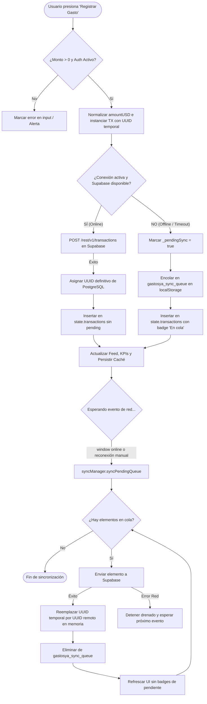

# Documento Técnico de Arquitectura y Optimizaciones: Fase 4 & UI/UX Venezuela

> **Proyecto:** GastosYa — Registro Rápido Multimoneda para Venezuela  
> **Versión:** 1.5.0 (Fase 4 BaaS + Optimizaciones de UI/UX y Reglas de Negocio)  
> **Estado:** Implementado, Optimizado y Desplegado en Producción  
> **Fecha:** Octubre 2026  
> **Autor:** Arquitecto de Software & Documentador Técnico Senior  

---

## Índice General

1. [Resumen de Arquitectura y Decisiones de Diseño](#1-resumen-de-arquitectura-y-decisiones-de-diseño)
   - [1.1 Visión General del Sistema](#11-visión-general-del-sistema)
   - [1.2 Por qué JAMstack + BaaS (Sin Servidor Node/Express Intermedio)](#12-por-qué-jamstack--baas-sin-servidor-nodeexpress-intermedio)
   - [1.3 El Perímetro de Seguridad en la Base de Datos](#13-el-perímetro-de-seguridad-en-la-base-de-datos)
2. [Capa de Datos y Seguridad en Supabase (PostgreSQL)](#2-capa-de-datos-y-seguridad-en-supabase-postgresql)
   - [2.1 Modelo Relacional de Tablas](#21-modelo-relacional-de-tablas)
   - [2.2 Justificación de Tipos: NUMERIC(14, 4) y TIMESTAMPTZ](#22-justificación-de-tipos-numeric14-4-y-timestamptz)
   - [2.3 Aislamiento Multitenant con Row Level Security (RLS)](#23-aislamiento-multitenant-con-row-level-security-rls)
   - [2.4 Trigger on_auth_user_created con SECURITY DEFINER](#24-trigger-on_auth_user_created-con-security-definer)
3. [Resiliencia de Red y Cola de Sincronización Offline (`syncManager.js`)](#3-resiliencia-de-red-y-cola-de-sincronización-offline-syncmanagerjs)
   - [3.1 Contexto de Conectividad en Venezuela](#31-contexto-de-conectividad-en-venezuela)
   - [3.2 Ciclo de Vida de una Transacción Offline](#32-ciclo-de-vida-de-una-transacción-offline)
   - [3.3 Diagrama de Flujo de Consistencia Eventual](#33-diagrama-de-flujo-de-consistencia-eventual)
   - [3.4 Reconciliación de Identificadores (UUID Cliente a UUID Servidor)](#34-reconciliación-de-identificadores-uuid-cliente-a-uuid-servidor)
4. [Automatización de Cotizaciones y Resiliencia en Red (`ratesManager.js`)](#4-automatización-de-cotizaciones-y-resiliencia-en-red-ratesmanagerjs)
   - [4.1 Integración con DolarApi Venezuela](#41-integración-con-dolarapi-venezuela)
   - [4.2 Patrón de Resiliencia: Promise.allSettled y AbortController](#42-patrón-de-resiliencia-promiseallsettled-y-abortcontroller)
   - [4.3 Jerarquía de Cotizaciones en 3 Niveles](#43-jerarquía-de-cotizaciones-en-3-niveles)
5. [Reglas de Negocio Venezolanas y Lógica de Conversión (`app.js`)](#5-reglas-de-negocio-venezolanas-y-lógica-de-conversión-appjs)
   - [5.1 Mapeo Directo e Inteligente de Divisas a Tasas](#51-mapeo-directo-e-inteligente-de-divisas-a-tasas)
   - [5.2 Equivalencia Cruzada Dinámica en Pantalla](#52-equivalencia-cruzada-dinámica-en-pantalla)
   - [5.3 La Regla del Snapshot Inmutable (Defensa contra la Inflación)](#53-la-regla-del-snapshot-inmutable-defensa-contra-la-inflación)
6. [Optimización de UI/UX Móvil y Accesibilidad](#6-optimización-de-uiux-móvil-y-accesibilidad)
   - [6.1 Deconstrucción y Limpieza de la Cabecera Móvil](#61-deconstrucción-y-limpieza-de-la-cabecera-móvil)
   - [6.2 Patrón de Modal Unificado de Configuración (`#modal-settings`)](#62-patrón-de-modal-unificado-de-configuración-modal-settings)
   - [6.3 Prevención de Desbordamiento Horizontal (Overflow Shield)](#63-prevención-de-desbordamiento-horizontal-overflow-shield)
7. [Guía de Despliegue y Ciclo de Vida en GitHub Pages](#7-guía-de-despliegue-y-ciclo-de-vida-en-github-pages)
   - [7.1 Flujo de Publicación CI/CD](#71-flujo-de-publicación-cicd)
   - [7.2 Análisis de Seguridad: SUPABASE_ANON_KEY vs. service_role](#72-análisis-de-seguridad-supabase_anon_key-vs-service_role)
   - [7.3 Configuración de Autenticación y Dominios en Supabase](#73-configuración-de-autenticación-y-dominios-en-supabase)
8. [Matriz de Archivos del Proyecto](#8-matriz-de-archivos-del-proyecto)

---

## 1. Resumen de Arquitectura y Decisiones de Diseño

### 1.1 Visión General del Sistema
GastosYa es una aplicación web progresiva y ultraliviana (Single Page Application, SPA) concebida para solventar la fricción diaria del registro contable en la economía multimoneda de Venezuela (Bolívares en efectivo/pago móvil, Dólares en efectivo, Zelle, USDT y Euros).

La arquitectura general del sistema desacopla completamente el frontend de la infraestructura de servidor mediante el patrón **JAMstack + Backend as a Service (BaaS)**:

```
┌────────────────────────────────────────────────────────────────────────┐
│                        CLIENTE (Navegador Móvil/Desktop)               │
│                                                                        │
│   HTML5 Semántico + CSS3 (Tokens & Variables) + Vanilla JS Modular     │
│   ┌─────────────────┐  ┌──────────────────┐  ┌─────────────────────┐   │
│   │  authManager.js │  │  syncManager.js  │  │   ratesManager.js   │   │
│   └────────┬────────┘  └────────┬─────────┘  └──────────┬──────────┘   │
│            │                    │                       │              │
│            ▼                    ▼                       ▼              │
│   ┌────────────────────────────────────────────────────────────────┐   │
│   │                 app.js (Coordinador & Calculator)              │   │
│   └─────────────────────────────┬──────────────────────────────────┘   │
│                                 │ supabaseClient.js                    │
└─────────────────────────────────┼──────────────────────────────────────┘
                                  │ HTTPS (REST / PostgREST + Auth JWT)
                                  ▼
┌────────────────────────────────────────────────────────────────────────┐
│                   SUPABASE PLATFORM (PostgreSQL 15+)                  │
│                                                                        │
│   ┌──────────────────────┐  ┌──────────────────────────────────────┐   │
│   │  GoTrue (Auth JWT)   │  │    PostgREST (Auto-generated APIs)   │   │
│   └──────────┬───────────┘  └──────────────────┬───────────────────┘   │
│              │                                 │                       │
│              ▼                                 ▼                       │
│   ┌────────────────────────────────────────────────────────────────┐   │
│   │                   POSTGRESQL RELATIONAL ENGINE                 │   │
│   │  - Row Level Security (RLS) estricto por usuario (auth.uid)    │   │
│   │  - Trigger SECURITY DEFINER (Seed de categorías)               │   │
│   │  - Tablas: categories, transactions, exchange_rates            │   │
│   └────────────────────────────────────────────────────────────────┘   │
└────────────────────────────────────────────────────────────────────────┘
```

### 1.2 Por qué JAMstack + BaaS (Sin Servidor Node/Express Intermedio)
Tradicionalmente, las aplicaciones web añaden una capa intermedia basada en Node.js, Express, Python o Go para exponer APIs REST, validar credenciales y consultar la base de datos. En GastosYa, **se descartó intencionalmente el servidor intermedio** por las siguientes razones de ingeniería:

1. **Latencia y Disponibilidad en Venezuela:** Un servidor intermedio introduce saltos adicionales de red (*network hops*). Si el servidor intermedio cae, la app muere. Al alojar el frontend como activos estáticos en los servidores perimetrales (CDN) globales de GitHub Pages, la aplicación carga de inmediato en milisegundos, incluso con conexiones 3G/LTE inestables.
2. **Cero Mantenimiento Operativo y Cero Costo:** No hay contenedores Docker que orquestar, certificados SSL que renovar, parches de seguridad de sistema operativo ni costos mensuales de VPS. Tanto GitHub Pages como el nivel gratuito de Supabase operan sin costo alguno para el caso de uso del proyecto.
3. **Vanilla JS sin Build Step:** La arquitectura elimina herramientas pesadas de compilación como Webpack, Vite o Babel. El código fuente es directamente ejecutable por el motor JavaScript del navegador, facilitando auditorías, edición inmediata y despliegues instantáneos vía Git.

### 1.3 El Perímetro de Seguridad en la Base de Datos
Prescindir de un backend tradicional suele plantear dudas sobre la seguridad. En un backend clásico, el servidor Node.js es el guardián de las reglas de negocio. En la arquitectura Supabase/PostgreSQL, **la base de datos es su propio guardián**.

Gracias a **Row Level Security (RLS)** y a la validación criptográfica de tokens JWT en el núcleo del motor relacional, los clientes pueden comunicarse directamente con PostgreSQL a través de la API PostgREST. No existe forma de que un cliente malicioso recupere o modifique datos ajenos simplemente alterando parámetros HTTP, porque cada fila devuelta es filtrada a nivel de tabla antes de salir de la base de datos.

---

## 2. Capa de Datos y Seguridad en Supabase (PostgreSQL)

### 2.1 Modelo Relacional de Tablas
El archivo [`docs/schema.sql`](./schema.sql) implementa un esquema completamente normalizado dentro de PostgreSQL:

```
┌───────────────────────────────────┐       ┌───────────────────────────────────┐
│         auth.users (Supabase)     │       │          public.categories        │
├───────────────────────────────────┤       ├───────────────────────────────────┤
│ id: UUID (PK)                     │◄──┐   │ id: UUID (PK, gen_random_uuid())  │
│ email: TEXT                       │   │   │ user_id: UUID (FK) NOT NULL ──────┤ (Cascade)
└───────────────────────────────────┘   │   │ name: TEXT NOT NULL               │
                                        │   │ icon: TEXT NOT NULL ('tag')       │
                                        │   │ color: TEXT NOT NULL ('#64748b')  │
                                        │   │ is_default: BOOLEAN (false)       │
                                        │   │ created_at: TIMESTAMPTZ (now())   │
                                        │   └─────────────────┬─────────────────┘
                                        │                     │
                                        │                     │ 1:N (ON DELETE SET NULL)
                                        │                     ▼
                                        │   ┌───────────────────────────────────┐
                                        │   │       public.transactions         │
                                        │   ├───────────────────────────────────┤
                                        └───┤ id: UUID (PK, gen_random_uuid())  │
                                            │ user_id: UUID (FK) NOT NULL ──────┤ (Cascade)
                                            │ category_id: UUID (FK, NULLABLE)  │
                                            │ amount_original: NUMERIC(14, 4)   │
                                            │ currency: TEXT (VES/USD/EUR/USDT) │
                                            │ rate_type: TEXT (BCV/PARALELO...) │
                                            │ rate_value: NUMERIC(14, 4)        │
                                            │ amount_usd: NUMERIC(14, 4)        │
                                            │ note: TEXT                        │
                                            │ spent_at: TIMESTAMPTZ (now())     │
                                            │ created_at: TIMESTAMPTZ (now())   │
                                            └───────────────────────────────────┘

┌───────────────────────────────────┐
│       public.exchange_rates       │
├───────────────────────────────────┤
│ id: UUID (PK, gen_random_uuid())  │
│ currency: TEXT NOT NULL           │
│ rate_type: TEXT NOT NULL          │
│ rate_value: NUMERIC(14, 4)        │
│ fetched_at: TIMESTAMPTZ (now())   │
└───────────────────────────────────┘
```

#### Restricciones de Integridad Críticas:
1. `UNIQUE (user_id, name)` en `categories`: Impide que un usuario cree dos categorías con nombres idénticos, evitando duplicados en la interfaz.
2. `CHECK (currency IN ('VES', 'USD', 'EUR', 'USDT'))` en `transactions`: Garantiza que únicamente divisas reconocidas entren al libro contable.
3. `CHECK (rate_type IN ('BCV', 'PARALELO', 'MANUAL', 'NONE'))`: Estandariza los tipos canónicos de cotización en el motor relacional.

---

### 2.2 Justificación de Tipos: `NUMERIC(14, 4)` y `TIMESTAMPTZ`

#### Por qué `NUMERIC(14, 4)` en lugar de `REAL` o `DOUBLE PRECISION`
En sistemas financieros, el uso de tipos de coma flotante binaria basados en el estándar IEEE 754 es una causa conocida de corrupción de datos contables:
```javascript
// Problema de precisión en coma flotante estándar:
0.1 + 0.2 === 0.30000000000000004 // true en JS y tipos FLOAT
```
En el contexto económico venezolano, concurren dos factores extremos:
1. **Magnitud Numérica Elevada:** Montos en Bolívares que pueden sumar millones o miles de millones.
2. **Sensibilidad Decimal en Tasas Cambiarias:** Las tasas cambiarias oficiales publicadas por el Banco Central de Venezuela cotizan habitualmente con hasta 4 cifras decimales (por ejemplo, `87.4215 Bs/$`).

El tipo `NUMERIC(14, 4)` de PostgreSQL utiliza aritmética decimal exacta en base 10:
* Permite almacenar hasta **10 dígitos enteros** (hasta `9,999,999,999.9999`), soportando amplias variaciones en Bolívares.
* Asigna **4 decimales exactos**, impidiendo discrepancias de redondeo al convertir de Bolívares a Dólares y preservando el centavo exacto.

#### Por qué `TIMESTAMPTZ` en lugar de `TIMESTAMP`
* `TIMESTAMP WITHOUT TIME ZONE` almacena solo año, mes, día y hora sin contexto de huso horario. Si un usuario registra un gasto en Caracas (`UTC-4`) y consulta su reporte desde otra zona horaria, las fechas se desfasan.
* `TIMESTAMPTZ` normaliza internamente la marca de tiempo a **UTC**. Al ser leída por el frontend en [`app.js`](file:///home/ado/Escritorio/Pagina-app%20de%20gastos/app.js), JavaScript utiliza `new Date(isoString)` para representarla automáticamente en la hora local del dispositivo del usuario.

---

### 2.3 Aislamiento Multitenant con Row Level Security (RLS)
En GastosYa, la seguridad multitenant es absoluta y descentralizada. Se activa RLS en cada tabla:

```sql
ALTER TABLE public.categories ENABLE ROW LEVEL SECURITY;
ALTER TABLE public.transactions ENABLE ROW LEVEL SECURITY;
```

Las políticas SQL vinculan cada fila al identificador criptográfico del usuario autenticado devuelto por `auth.uid()`:

```sql
-- Políticas para la tabla categories
CREATE POLICY "Users can view own categories"
    ON public.categories FOR SELECT
    USING (auth.uid() = user_id);

CREATE POLICY "Users can insert own categories"
    ON public.categories FOR INSERT
    WITH CHECK (auth.uid() = user_id);

CREATE POLICY "Users can update own categories"
    ON public.categories FOR UPDATE
    USING (auth.uid() = user_id)
    WITH CHECK (auth.uid() = user_id);

CREATE POLICY "Users can delete own categories"
    ON public.categories FOR DELETE
    USING (auth.uid() = user_id);
```

#### Ventaja Arquitectónica:
Un atacante que intente forzar una llamada mediante PostgREST ejecutando:
`curl -X GET "https://...supabase.co/rest/v1/transactions?user_id=eq.OTRO_USUARIO"`
recibirá un conjunto vacío `[]` con código HTTP 200, porque el motor de PostgreSQL inyecta internamente `AND user_id = auth.uid()` en el plan de ejecución de la consulta.

---

### 2.4 Trigger `on_auth_user_created` con `SECURITY DEFINER`

#### El Reto de la Autonomía de Categorías
En las versiones iniciales de la aplicación, existían categorías globales compartidas. Esto creaba fricción: los usuarios no podían renombrar o eliminar categorías globales sin afectar a los demás. La decisión arquitectónica fue dotar a cada nuevo usuario de su propio conjunto independiente de categorías editables.

#### Implementación del Trigger:
```sql
CREATE OR REPLACE FUNCTION public.handle_new_user_categories()
RETURNS TRIGGER
LANGUAGE plpgsql
SECURITY DEFINER
SET search_path = public
AS $$
BEGIN
    INSERT INTO public.categories (user_id, name, icon, color, is_default)
    VALUES
        (NEW.id, 'Comida',     '🍔', '#f59e0b', true),
        (NEW.id, 'Mercado',    '🛒', '#10b981', true),
        (NEW.id, 'Transporte', '🚗', '#3b82f6', true),
        (NEW.id, 'Servicios',  '💡', '#8b5cf6', true),
        (NEW.id, 'Farmacia',   '💊', '#ec4899', true),
        (NEW.id, 'Otros',      '📦', '#64748b', true)
    ON CONFLICT (user_id, name) DO NOTHING;
    RETURN NEW;
END;
$$;

CREATE TRIGGER on_auth_user_created
    AFTER INSERT ON auth.users
    FOR EACH ROW
    EXECUTE FUNCTION public.handle_new_user_categories();
```

#### Por qué `SECURITY DEFINER`:
Cuando un usuario se registra mediante `supabase.auth.signUp()`, la fila se crea en el esquema `auth.users`. En ese milisegundo, la sesión del usuario aún no tiene el token JWT activo en la base de datos para satisfacer la política RLS de `INSERT` sobre `public.categories`. La cláusula `SECURITY DEFINER` le instruye a PostgreSQL que ejecute la función con los privilegios del creador de la función (administrador/postgres), evitando rechazos por RLS e inyectando las 6 categorías iniciales de manera transparente.

---

## 3. Resiliencia de Red y Cola de Sincronización Offline (`syncManager.js`)

### 3.1 Contexto de Conectividad en Venezuela
En Venezuela, las interrupciones en el suministro eléctrico y las fluctuaciones en la cobertura móvil (pérdida súbita de señal 4G o congestión de datos) son comunes al momento de pagar en comercios. Una aplicación financiera que dependa de conexión continua para registrar un gasto resultaría inoperable en la práctica.

Por ello, el módulo [`syncManager.js`](file:///home/ado/Escritorio/Pagina-app%20de%20gastos/syncManager.js) implementa un modelo de **escritura optimista con consistencia eventual**.

---

### 3.2 Ciclo de Vida de una Transacción Offline
El ciclo de vida completo de un gasto se rige por las siguientes fases:

1. **Generación Local (ID Temporal):** Al presionar "Registrar Gasto", la aplicación genera un UUID válido en el cliente mediante `crypto.randomUUID()` y marca la propiedad `_pendingSync = false`.
2. **Evaluación de Conectividad:** Se comprueba `navigator.onLine` y la respuesta del cliente de Supabase.
3. **Bifurcación Offline:** Si la llamada a Supabase arroja error de red o la conexión está inactiva:
   * La transacción cambia a `_pendingSync = true`.
   * Se almacena de inmediato en la cola `localStorage.getItem('gastosya_sync_queue')`.
   * Se inserta en el array en memoria `state.transactions`.
   * La interfaz dibuja la tarjeta con el badge visual: `🟡 En cola`.
4. **Reconexión Automática:** El navegador detecta la vuelta de la señal y dispara el evento nativo `window.addEventListener('online', ...)`.
5. **Drenado y Reemplazo:** [`syncManager.js`](file:///home/ado/Escritorio/Pagina-app%20de%20gastos/syncManager.js) consume secuencialmente la cola, remueve el registro local y lo inserta en Supabase, actualizando el ID definitivo de PostgreSQL sin alterar la experiencia de usuario.

---

### 3.3 Diagrama de Flujo de Consistencia Eventual



---

### 3.4 Reconciliación de Identificadores (UUID Cliente a UUID Servidor)
Uno de los mayores desafíos al implementar colas offline es la integridad referencial de los identificadores.
* **Problema:** Si el usuario elimina o filtra una transacción recién creada mientras sigue sin internet, el sistema necesita un identificador unívoco para operar en el DOM.
* **Solución de GastosYa:** Al registrar offline, se asigna `tx.id = crypto.randomUUID()`. Cuando `syncManager` finalmente inserta la transacción en Supabase mediante:
  ```javascript
  const { data, error } = await client.from('transactions').insert(dbPayload).select().single();
  ```
  El servidor PostgreSQL devuelve el registro creado con su clave primaria definitiva `data.id`. El método de sincronización busca en memoria la coincidencia por el ID temporal antiguo y lo actualiza:
  ```javascript
  const memTx = state.transactions.find(t => t.id === queueItem.id);
  if (memTx) {
    memTx.id = data.id;
    memTx._pendingSync = false;
  }
  ```
  De esta forma, la interfaz no sufre parpadeos ni inconsistencias de claves.

---

## 4. Automatización de Cotizaciones y Resiliencia en Red (`ratesManager.js`)

### 4.1 Integración con DolarApi Venezuela
El módulo [`ratesManager.js`](file:///home/ado/Escritorio/Pagina-app%20de%20gastos/ratesManager.js) automatiza la obtención de cotizaciones financieras en tiempo real utilizando la API pública venezolana de DolarApi:

| Cotización | Endpoint Consumido | Parámetro Extraído | Aplicación en GastosYa |
| :--- | :--- | :---: | :--- |
| **Dólar Oficial BCV** | `https://ve.dolarapi.com/v1/dolares/oficial` | `.promedio` | Tasa base oficial de referencia cambiaria |
| **Dólar Paralelo** | `https://ve.dolarapi.com/v1/dolares/paralelo` | `.promedio` | Referencia de mercado libre y Binance P2P |
| **Euro Oficial BCV** | `https://ve.dolarapi.com/v1/euros/oficial` | `.promedio` | Conversión oficial para pagos en Euros |

---

### 4.2 Patrón de Resiliencia: `Promise.allSettled` y `AbortController`
Las conexiones móviles pueden experimentar peticiones que quedan en estado pendiente indefinido (*hanging requests*). Para garantizar que el módulo de tasas nunca bloquee el hilo principal de renderizado ni consuma batería innecesariamente, se aplica el siguiente patrón de diseño:

```javascript
const controller = new AbortController();
const timeoutId = setTimeout(() => controller.abort(), 7000); // 7 segundos estrictos

try {
  const [bcvRes, parRes, eurRes] = await Promise.allSettled([
    fetch('https://ve.dolarapi.com/v1/dolares/oficial', { signal: controller.signal }),
    fetch('https://ve.dolarapi.com/v1/dolares/paralelo', { signal: controller.signal }),
    fetch('https://ve.dolarapi.com/v1/euros/oficial', { signal: controller.signal })
  ]);
  clearTimeout(timeoutId);
  // Procesamiento seguro incluso si uno de los 3 falla
} catch (err) {
  // Manejo de contingencia
}
```

* **`AbortController`:** Corta la conexión a los 7 segundos si la red está colapsada.
* **`Promise.allSettled`:** A diferencia de `Promise.all` (que falla si una sola promesa es rechazada), `allSettled` permite que si el endpoint de Euro responde pero el de Paralelo falla, la tasa de Euro se actualice correctamente sin interrumpir el resto de la aplicación.

---

### 4.3 Jerarquía de Cotizaciones en 3 Niveles
El sistema implementa una arquitectura escalonada en 3 capas de resguardo:

```
┌─────────────────────────────────────────────────────────────┐
│ NIVEL 1: Caché Local Inmediato (localStorage)               │
│ - Se lee síncronamente al cargar index.html                 │
│ - Inyecta instantáneamente las tasas previas                │
│ - Ticker muestra: "Caché: hoy 14:30"                        │
└──────────────────────────────┬──────────────────────────────┘
                               │ Si hay red disponible
                               ▼
┌─────────────────────────────────────────────────────────────┐
│ NIVEL 2: API Externa en Vivo (DolarApi Venezuela)           │
│ - Consulta asíncrona con AbortController (7s)               │
│ - Actualiza state.rates y guarda nuevo timestamp en caché   │
│ - Ticker muestra: "En vivo: hoy 14:35"                      │
│ - Opcional: Registra snapshot histórico en exchange_rates   │
└──────────────────────────────┬──────────────────────────────┘
                               │ Si la API falla y no hay caché
                               ▼
┌─────────────────────────────────────────────────────────────┐
│ NIVEL 3: Valores Predeterminados de Contingencia (Hardcoded)│
│ - Tasas fijas mínimas en app.js (ej. BCV 45.20, Par 52.10)  │
│ - Garantiza que calculator nunca divida por cero            │
└─────────────────────────────────────────────────────────────┘
```

---

## 5. Reglas de Negocio Venezolanas y Lógica de Conversión (`app.js`)

### 5.1 Mapeo Directo e Inteligente de Divisas a Tasas
En la economía de Venezuela, cada divisa utilizada en el comercio informal o formal tiene un mercado de referencia natural. Para eliminar pasos redundantes al usuario, el manejador `handlers.onCurrencyChange` en [`app.js`](file:///home/ado/Escritorio/Pagina-app%20de%20gastos/app.js) implementa un mapeo automatizado:

```
┌─────────────────┐       ┌────────────────────────┐       ┌──────────────────────────┐
│ Divisa de Pago  │ ────► │  Tasa Asignada en App  │ ────► │  Comportamiento en UI    │
├─────────────────┼───────┼────────────────────────┼───────┼──────────────────────────┤
│ USDT (Crypto)   │ ────► │ PARALELO (Binance P2P) │ ────► │ Oculta selector de tasas │
│ USD (Dólares)   │ ────► │ BCV (Oficial BCV USD)  │ ────► │ Oculta selector de tasas │
│ EUR (Euros)     │ ────► │ BCV_EUR (Euro Oficial) │ ────► │ Oculta selector de tasas │
│ VES (Bolívares) │ ────► │ Selección del Usuario  │ ────► │ Muestra selector BCV/Par │
└─────────────────┘       └────────────────────────┘       └──────────────────────────┘
```

#### Regla de Interfaz:
Cuando el usuario selecciona una divisa extranjera (`USD`, `EUR`, `USDT`), la tarjeta de tasa de cambio se oculta automáticamente mediante la clase `.is-hidden`, pues el cálculo hacia Bolívares o USD se resuelve de forma directa. La selección de tasa solo se despliega cuando la divisa de origen es `VES`.

---

### 5.2 Equivalencia Cruzada Dinámica en Pantalla
El método `calculator.calculateEquivalence()` en [`app.js`](file:///home/ado/Escritorio/Pagina-app%20de%20gastos/app.js) resuelve una necesidad clave de experiencia de usuario en Venezuela: **conocer el contravalor de lo que se está pagando en la otra moneda en tiempo real**.

1. **Cuando se paga en Bolívares (VES):**
   * El usuario introduce `1000 Bs.` y selecciona tasa BCV (ej. `45.20 Bs/$`).
   * La barra de previsualización muestra: **`≈ $22.12 USD`**.
   * Fórmula: $\text{amountUSD} = \frac{\text{montoVES}}{\text{tasa}}$

2. **Cuando se paga en Divisas Extranjeras (USD, EUR, USDT):**
   * El usuario introduce `$20 USD`.
   * La barra de previsualización muestra: **`≈ Bs. 904.00`** (usando la tasa BCV).
   * Si introduce `20 USDT`, muestra: **`≈ Bs. 1,042.00`** (usando la tasa Paralelo).
   * Si introduce `20 EUR`, muestra: **`≈ Bs. 986.00`** (usando la tasa Euro Oficial).

Esto le permite a la persona confirmar inmediatamente si el monto facturado en el punto de venta o en el comercio coincide con la cotización del día.

---

### 5.3 La Regla del Snapshot Inmutable (Defensa contra la Inflación)

#### El Problema de la Recalculación Dinámica:
Imaginemos una aplicación contable que solo guarda en la base de datos el monto original en Bolívares (`100 Bs.`) y calcula el equivalente en dólares en tiempo real al mostrar las gráficas.

* En Enero, el usuario pagó un almuerzo de `100 Bs.` con una tasa de `25 Bs/$`. En ese instante, el gasto representó **$4.00 USD**.
* En Julio, la tasa de cambio subió a `50 Bs/$`. Si la aplicación recalcula la transacción de Enero, afirmará que el almuerzo costó **$2.00 USD**.
* **Resultado:** Las métricas de consumo histórico, presupuestos mensuales y analíticas anuales quedan falseadas e inutilizables por efecto de la inflación.

#### La Solución Arquitectónica de GastosYa:
En el momento exacto en que la transacción se envía (`handlers.onFormSubmit`), el monto equivalente en dólares se computa matemáticamente y se congela permanentemente en la columna `amount_usd`:

```javascript
const amountUSD = calculator.normalizeToUSD(amountVal, state.currentCurrency, rateValue);
```

```sql
INSERT INTO public.transactions (..., amount_original, currency, rate_value, amount_usd, spent_at)
VALUES (..., 100.0000, 'VES', 25.0000, 4.0000, '2026-01-15T12:00:00Z');
```

Incluso si la tasa en el ticker sube a `500 Bs/$` en el futuro, el campo `amount_usd` de esa fila continuará valiendo exactamente `$4.00 USD`. Esto garantiza comparabilidad estadística y fidelidad del poder adquisitivo a lo largo del tiempo.

---

## 6. Optimización de UI/UX Móvil y Accesibilidad

### 6.1 Deconstrucción y Limpieza de la Cabecera Móvil
En la versión inicial de la aplicación, la cabecera en pantallas móviles pequeñas (menos de 380px de ancho) sufría de sobrecarga de elementos y desbordamiento:
* Convivían el logo, el título "GastosYa", un badge decorativo que decía "Rápido", un botón para alternar temas, un botón de actualización de tasas, y un botón con el correo del usuario (que salía cortado como `usuario...@...`).
* El ticker de 3 tasas en la fila inferior provocaba saltos de línea irregulares.

#### Acciones de Optimización Realizadas:
1. **Eliminación de Elementos Redundantes:** Se removió la etiqueta `.brand-badge` ("Rápido"), liberando valioso espacio horizontal.
2. **Reubicación de la Información de Usuario:** Se eliminó el texto del correo electrónico de la barra superior. En su lugar, se integró un botón de ajustes unificado con icono de engranaje (`#btn-open-settings`).
3. **Organización del Ticker:** El ticker de 3 columnas (`BCV $`, `Euro`, `Paralelo`) se ajustó a una cuadrícula CSS con `white-space: nowrap`, `font-size: 0.72rem` y espacios mínimos (`gap: 0.25rem - 0.4rem`), garantizando visualización limpia en pantallas de hasta 320px de ancho (iPhone SE).

---

### 6.2 Patrón de Modal Unificado de Configuración (`#modal-settings`)
Para centralizar todas las preferencias del sistema sin saturar la pantalla principal, se diseñó el modal semántico y accesible [`#modal-settings`](file:///home/ado/Escritorio/Pagina-app%20de%20gastos/index.html#L614-L715):

```
┌─────────────────────────────────────────────────────────────┐
│ ⚙️ Configuración y Preferencias                            [✕]│
├─────────────────────────────────────────────────────────────┤
│ 👤 CUENTA ACTIVA                                            │
│ ┌─────────────────────────────────────────────────────────┐ │
│ │ [👤]  usuario.completo@gmail.com                        │ │
│ │       ● Sesión activa en Supabase Cloud                 │ │
│ └─────────────────────────────────────────────────────────┘ │
│                                                             │
│ 🎨 TEMA VISUAL (8 temas suaves diseñados)                   │
│ ┌───────────────────────┐   ┌───────────────────────────┐   │
│ │ (●) Esmeralda (Activo)│   │ ( ) Amatista              │   │
│ ├───────────────────────┤   ├───────────────────────────┤   │
│ │ ( ) Ámbar             │   │ ( ) Zafiro                │   │
│ ├───────────────────────┤   ├───────────────────────────┤   │
│ │ ( ) Rosa Pastel       │   │ ( ) Salvia                │   │
│ ├───────────────────────┤   ├───────────────────────────┤   │
│ │ ( ) Nordic Blue       │   │ ( ) OLED Puro             │   │
│ └───────────────────────┘   └───────────────────────────┘   │
│                                                             │
│ 🚪 [      Cerrar Sesión Activa (Botón Destructivo)       ] │
└─────────────────────────────────────────────────────────────┘
```

#### Ventajas del Patrón:
* **Accesibilidad:** El modal cumple con atributos ARIA (`role="dialog"`, `aria-modal="true"`, `aria-labelledby`).
* **Visualización Completa del Correo:** La dirección de correo no sufre recortes gracias a la propiedad CSS `word-break: break-all;`.
* **Conmutador de 8 Temas:** Permite cambiar el tema visual en vivo manteniendo la preferencia persistida en `localStorage.getItem('gastosya_theme')`.
* **Cierre de Sesión Seguro:** Al presionar "Cerrar Sesión", el sistema cierra el modal, ejecuta `supabase.auth.signOut()` y activa inmediatamente la pantalla de bloqueo de autenticación.

---

### 6.3 Prevención de Desbordamiento Horizontal (Overflow Shield)
Para impedir que la interfaz desarrolle scroll horizontal no deseado en dispositivos móviles, se aplicaron reglas defensivas en [`styles.css`](file:///home/ado/Escritorio/Pagina-app%20de%20gastos/styles.css):

```css
/* Escudo contra desbordamiento en elementos clave */
.rate-pill {
  min-width: 0;
  overflow: hidden;
  white-space: nowrap;
}

.rate-name,
.rate-val {
  white-space: nowrap;
  flex-shrink: 0;
}

.settings-user-email {
  word-break: break-all;
  overflow-wrap: anywhere;
}
```

---

## 7. Guía de Despliegue y Ciclo de Vida en GitHub Pages

### 7.1 Flujo de Publicación CI/CD
El flujo de desarrollo y despliegue del proyecto utiliza Git y GitHub Pages como tubería de entrega continua (CD):

```bash
# 1. Verificar estado de cambios
git status

# 2. Agregar archivos modificados a staging
git add .

# 3. Crear commit semántico
git commit -m "feat: optimizaciones de UI/UX móvil y lógica de conversión cruzada"

# 4. Enviar cambios a la rama principal de GitHub
git push origin main
```

Una vez ejecutado el push, GitHub Pages detecta los cambios en la rama `main` y actualiza la versión pública del sitio web en segundos sin intervención manual.

---

### 7.2 Análisis de Seguridad: `SUPABASE_ANON_KEY` vs. `service_role`
Una inquietud frecuente al trabajar con arquitecturas frontend estáticas es la presencia de la clave de Supabase en el código fuente de [`supabaseClient.js`](file:///home/ado/Escritorio/Pagina-app%20de%20gastos/supabaseClient.js):

```javascript
const SUPABASE_URL = 'https://vahjbamwhbheqiaecobm.supabase.co';
const SUPABASE_ANON_KEY = 'sb_publishable_...';
```

#### Diferenciación de Claves:
1. **`anon` / `publishable` Key (PÚBLICA POR DISEÑO):**
   * Es el equivalente a la dirección de una casa o al puerto público de un servidor web.
   * Supabase exige que esta clave esté en el navegador para que el cliente pueda identificarse ante la pasarela de la API.
   * **No otorga permisos por sí misma:** Cualquier consulta realizada con esta clave es evaluada contra las políticas RLS de PostgreSQL. Si el usuario no tiene una sesión válida o intenta acceder a filas de otro usuario, la base de datos rechaza la operación.
2. **`service_role` / `secret` Key (ESTRICTAMENTE PRIVADA):**
   * Esta clave omite todas las políticas RLS (*bypasses all security rules*).
   * **NUNCA DEBE INCLUIRSE EN EL FRONTEND NI EN REPOSITORIOS PÚBLICOS.** En GastosYa, la clave `service_role` jamás ha sido insertada en ningún archivo del cliente.

---

### 7.3 Configuración de Autenticación y Dominios en Supabase
Para que la autenticación funcione de forma óptima en producción sobre GitHub Pages, se deben verificar dos parámetros en el [Dashboard de Supabase](https://supabase.com/dashboard) dentro de **Authentication > URL Configuration**:

1. **Site URL:**
   Debe apuntar a la URL pública asignada por GitHub Pages:
   `https://polnareff-2006.github.io/GastosYa/`
2. **Redirect URLs:**
   Añadir la misma URL con comodín de ruta:
   `https://polnareff-2006.github.io/GastosYa/**`
   Esto garantiza que los enlaces mágicos (*magic links*) o confirmaciones por correo electrónico redireccionen al usuario a la aplicación desplegada y no a `localhost`.

---

## 8. Matriz de Archivos del Proyecto

| Ruta de Archivo | Responsabilidad Principal | Módulo / Fase |
| :--- | :--- | :---: |
| [`index.html`](file:///home/ado/Escritorio/Pagina-app%20de%20gastos/index.html) | Estructura semántica, accesibilidad ARIA, modales y CDN de Supabase | Vista Única (SPA) |
| [`styles.css`](file:///home/ado/Escritorio/Pagina-app%20de%20gastos/styles.css) | Sistema de diseño de 8 temas, variables CSS, layout responsivo y estados | Capa de Presentación |
| [`supabaseClient.js`](file:///home/ado/Escritorio/Pagina-app%20de%20gastos/supabaseClient.js) | Inicialización segura del cliente oficial `@supabase/supabase-js` | Cliente BaaS |
| [`authManager.js`](file:///home/ado/Escritorio/Pagina-app%20de%20gastos/authManager.js) | Login, registro, logout, listener reactivo de sesión y manejo de errores | Autenticación |
| [`syncManager.js`](file:///home/ado/Escritorio/Pagina-app%20de%20gastos/syncManager.js) | Detección de red, cola offline `localStorage` y drenado a Supabase | Resiliencia Offline |
| [`ratesManager.js`](file:///home/ado/Escritorio/Pagina-app%20de%20gastos/ratesManager.js) | Consulta de DolarApi con timeout (7s), respaldo en caché y ticker | Automatización de Tasas |
| [`app.js`](file:///home/ado/Escritorio/Pagina-app%20de%20gastos/app.js) | Coordinador principal, calculadora, snapshot inmutable y CRUD de gastos | Lógica de Negocio |
| [`docs/schema.sql`](file:///home/ado/Escritorio/Pagina-app%20de%20gastos/docs/schema.sql) | DDL canónico de PostgreSQL, políticas RLS, índices y triggers | Base de Datos |
| [`docs/data-model.md`](file:///home/ado/Escritorio/Pagina-app%20de%20gastos/docs/data-model.md) | Especificación matemática canónica de normalización a USD | Documentación Fase 3 |
| [`docs/phase-4-backend-baas.md`](file:///home/ado/Escritorio/Pagina-app%20de%20gastos/docs/phase-4-backend-baas.md) | Informe de cierre inicial de la migración a Supabase | Documentación Fase 4 |
| [`docs/fase-4-backend-optimizaciones-tecnicas.md`](file:///home/ado/Escritorio/Pagina-app%20de%20gastos/docs/fase-4-backend-optimizaciones-tecnicas.md) | **Este documento:** Manual exhaustivo de arquitectura y optimizaciones | Referencia Técnica Global |
