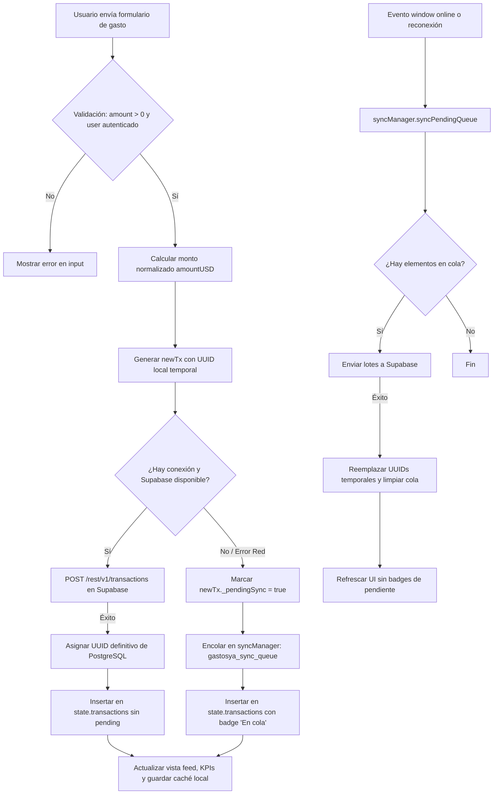

# Documento Técnico de Arquitectura: Fase 4 - Backend as a Service (BaaS) con Supabase

> **Proyecto:** GastosYa — Registro Rápido Multimoneda para Venezuela  
> **Versión:** 1.4.0 (Fase 4)  
> **Estado:** Implementado y Operativo  
> **Fecha:** Octubre 2026  
> **Autor:** Equipo de Arquitectura e Implementación Frontend & Base de Datos  

---

## 1. Resumen Ejecutivo de la Fase 4

### 1.1 Objetivos Alcanzados
La Fase 4 transformó **GastosYa** de una aplicación de prototipado puramente local (basada en almacenamiento `localStorage` y datos semilla) a una solución de producción resiliente, segura y multiusuario sobre la nube, manteniendo cero costo de infraestructura fija.

Los hitos clave completados son:
1. **Fase 4.1 (Persistencia Relacional):** Diseño y ejecución del esquema DDL en PostgreSQL dentro de Supabase, restricciones matemáticas estrictas, índices de alto rendimiento y políticas RLS multitenant.
2. **Fase 4.2 (Autenticación Reactiva):** Integración del SDK oficial de Supabase (`@supabase/supabase-js`), modal de autenticación accesible con diseño acorde a los 8 temas del sistema, y gestión reactiva de sesión con desacoplamiento mediante eventos custom.
3. **Fase 4.3 (Consistencia Eventual y Modo Offline):** Desacoplamiento total de datos simulados (*mock data*), soporte para trabajo sin conexión mediante la cola `gastosya_sync_queue` y drenado automático a Supabase al reconectar.
4. **Fase 4.4 (Automatización de Cotizaciones Cambiarias):** Consumo automatizado de tasas oficiales (BCV USD/EUR) y de mercado (Paralelo) desde la API pública venezolana de DolarApi, con fallback en 3 niveles y preservación de edición manual.

### 1.2 Justificación del Cambio Arquitectónico (JAMstack + BaaS)
La decisión de combinar un **Frontend Estático (HTML5, Vanilla CSS3, Vanilla JS) alojado en GitHub Pages** con un **Backend as a Service (Supabase)** responde a las siguientes necesidades estratégicas:

* **Latencia Mínima y Simplicidad:** Al no requerir un servidor Node.js/Python intermedio para renderizado o proxy, los activos estáticos son servidos instantáneamente vía CDN global.
* **Costo Operativo Cero:** El nivel gratuito (*Free Tier*) de Supabase proporciona PostgreSQL gestionado, autenticación JWT y almacenamiento con límites ampliamente holgados para el volumen de usuarios proyectado.
* **Resiliencia ante Conectividad Inestable en Venezuela:** Centralizar la lógica de persistencia y cola offline en el cliente garantiza que caídas de red o cortes de energía no impidan registrar un gasto en la calle.
* **Mantenibilidad:** El código frontend se mantiene 100% fiel al principio de Vanilla JS sin dependencias pesadas de construcción (*zero build tools*, sin Webpack/Vite obligatorio para desplegar).

---

## 2. Arquitectura de Datos y Seguridad (Fases 4.1 y 4.2)

### 2.1 Modelo Relacional en PostgreSQL
El esquema completo implementado en el archivo [`docs/schema.sql`](./schema.sql) define tres tablas principales dentro del esquema `public`:

```
┌─────────────────────────────────┐       ┌─────────────────────────────────┐
│        auth.users (JWT)         │       │          categories             │
├─────────────────────────────────┤       ├─────────────────────────────────┤
│ id: UUID (PK)                   │◄──┐   │ id: UUID (PK)                   │◄──┐
│ email: TEXT                     │   │   │ user_id: UUID (FK) NOT NULL     ├───┘ (Aislamiento)
└─────────────────────────────────┘   ├───┤ name: TEXT NOT NULL             │
                                      │   │ icon: TEXT                      │
                                      │   │ color: TEXT                     │
                                      │   │ is_default: BOOLEAN             │
                                      │   │ created_at: TIMESTAMPTZ         │
                                      │   └─────────────────────────────────┘
                                      │                   ▲
                                      │                   │ ON DELETE SET NULL
                                      │   ┌───────────────┴─────────────────┐
                                      │   │          transactions           │
                                      │   ├─────────────────────────────────┤
                                      └───┤ id: UUID (PK)                   │
                                          │ user_id: UUID (FK) NOT NULL     │
                                          │ category_id: UUID (FK, NULLABLE)│
                                          │ amount_original: NUMERIC(14, 4) │
                                          │ currency: TEXT                  │
                                          │ rate_type: TEXT                 │
                                          │ rate_value: NUMERIC(14, 4)      │
                                          │ amount_usd: NUMERIC(14, 4)      │
                                          │ note: TEXT                      │
                                          │ spent_at: TIMESTAMPTZ           │
                                          │ created_at: TIMESTAMPTZ         │
                                          └─────────────────────────────────┘

┌─────────────────────────────────┐
│         exchange_rates          │
├─────────────────────────────────┤
│ id: UUID (PK)                   │
│ currency: TEXT                  │
│ rate_type: TEXT                 │
│ rate_value: NUMERIC(14, 4)      │
│ fetched_at: TIMESTAMPTZ         │
└─────────────────────────────────┘
```

### 2.2 Justificación de Tipos de Datos y Precisión Financiera
* **`NUMERIC(14, 4)` vs `FLOAT`:**  
  En sistemas contables multimoneda sujetos a hiperinflación o fluctuaciones cambiarias bruscas, los números de punto flotante binario (`REAL` / `DOUBLE PRECISION`) generan errores de redondeo acumulativos impredecibles (ej. `0.1 + 0.2 = 0.30000000000000004`). El tipo `NUMERIC(14, 4)` asegura aritmética de punto fijo con hasta 10 dígitos enteros y 4 decimales exactos, permitiendo capturar cotizaciones que cotizan al cuarto decimal (ej. BCV `875.6505 Bs/$`).
* **`TIMESTAMPTZ` vs `TIMESTAMP`:**  
  Permite almacenar marcas de tiempo normalizadas a UTC en la base de datos sin importar la zona horaria del dispositivo emisor (`VET -04:00`, `UTC`, etc.), garantizando comparaciones cronológicas deterministas.

### 2.3 Row Level Security (RLS) y Trigger `on_auth_user_created`
La seguridad en Supabase no recae en un servidor API intermedio, sino en el motor PostgreSQL mediante **Row Level Security (RLS)**:

1. **Aislamiento Multitenant en `categories` y `transactions`:**
   * Todas las operaciones CRUD (`SELECT`, `INSERT`, `UPDATE`, `DELETE`) validan estrictamente `auth.uid() = user_id`.
   * Un usuario no puede consultar, alterar ni borrar registros pertenecientes a otro usuario, incluso si manipula los parámetros de la solicitud HTTP en el navegador.
2. **Trigger de Auto-Inicialización de Categorías:**
   * Dado que cada usuario debe ser libre de editar, renombrar o eliminar cualquier categoría sin colisionar con categorías globales compartidas, se implementó la función:
     ```sql
     CREATE OR REPLACE FUNCTION public.handle_new_user_categories()
     RETURNS TRIGGER
     LANGUAGE plpgsql
     SECURITY DEFINER
     SET search_path = public
     AS $$
     BEGIN
         INSERT INTO public.categories (user_id, name, icon, color, is_default)
         VALUES
             (NEW.id, 'Comida',     '🍔', '#f59e0b', true),
             (NEW.id, 'Mercado',    '🛒', '#10b981', true),
             (NEW.id, 'Transporte', '🚗', '#3b82f6', true),
             (NEW.id, 'Servicios',  '💡', '#8b5cf6', true),
             (NEW.id, 'Farmacia',   '💊', '#ec4899', true),
             (NEW.id, 'Otros',      '📦', '#64748b', true)
         ON CONFLICT (user_id, name) DO NOTHING;
         RETURN NEW;
     END;
     $$;
     ```
   * **`SECURITY DEFINER`** permite que la función se ejecute con privilegios de superusuario para escribir en la tabla `categories` en el instante exacto en que `auth.users` crea la fila, saltándose la restricción temporal antes de que el cliente reciba su token JWT inicial.

### 2.4 Flujo Reactivo de Autenticación (`onAuthStateChange`)
El archivo [`authManager.js`](../authManager.js) administra la sesión con el listener de Supabase:
```javascript
client.auth.onAuthStateChange((event, session) => {
  this.handleSessionUpdate(event, session);
});
```
* **Si `session` es nula:** Activa la clase CSS `auth-locked` sobre el `<body>`, abre el modal accesible `#modal-auth` y bloquea la navegación e interacción.
* **Si `session` existe:** Remueve el bloqueo, actualiza la interfaz con el correo del usuario y emite un evento desacoplado `window.dispatchEvent(new CustomEvent('gastosya:auth-changed', { detail: { session, user } }))`. Esto permite que [`app.js`](../app.js) y [`syncManager.js`](../syncManager.js) inicialicen la carga de datos sin acoplarse directamente a la lógica de login/registro.

---

## 3. Estrategia Offline y Consistencia Eventual (Fase 4.3)

### 3.1 Diagrama de Flujo: Registro Online vs Offline
El registro de un gasto sigue un patrón de **escritura optimista** con recuperación automática ante fallas de conectividad:



### 3.2 Manejo de Identificadores y Cola `gastosya_sync_queue`
1. **Identificadores Temporales:** Al registrar sin internet, `crypto.randomUUID()` asigna un UUID cliente válido para permitir que los botones de eliminar y los filtros de la interfaz operen con normalidad en el DOM.
2. **Persistencia en LocalStorage:** La cola `gastosya_sync_queue` almacena los objetos serializados en formato estándar.
3. **Drenado Atómico:** Al detectar el evento `online` o arrancar sesión con elementos pendientes:
   * `syncManager` itera sobre la cola ejecutando inserciones directas en Supabase.
   * Al recibir la respuesta exitosa de PostgreSQL, busca la transacción en el arreglo de memoria `state.transactions` mediante el ID temporal, le asigna el nuevo `id` oficial generado por PostgreSQL, elimina la bandera `_pendingSync` y la retira de `gastosya_sync_queue`.
   * Si la red se corta a mitad del proceso, la ejecución se detiene de inmediato preservando los elementos restantes en la cola para la próxima reconexión.

---

## 4. Automatización de Tasas de Cambio (Fase 4.4)

### 4.1 Endpoints de DolarApi Venezuela
El módulo [`ratesManager.js`](../ratesManager.js) consume los siguientes servicios HTTP públicos:

| Tipo de Cotización | URL Endpoint | Campo Extraído | Uso en GastosYa |
| :--- | :--- | :---: | :--- |
| **Dólar Oficial BCV** | `https://ve.dolarapi.com/v1/dolares/oficial` | `promedio` | Conversión base de Bolívares a USD |
| **Dólar Paralelo** | `https://ve.dolarapi.com/v1/dolares/paralelo` | `promedio` | Referencia de mercado alternativo |
| **Euro Oficial BCV** | `https://ve.dolarapi.com/v1/euros/oficial` | `promedio` | Cálculo de factor cruzado EUR/USD |

### 4.2 Estrategia de Fallback en 3 Niveles
Para evitar que un bloqueo de red o lentitud en la API externa congele la interfaz, se utiliza una estrategia escalonada:

1. **Nivel 1 (Caché Local Inmediato):**  
   Al arrancar, lee de forma síncrona `localStorage.getItem('gastosya_cached_rates')`. Si existen cotizaciones previas, las inyecta instantáneamente en el ticker de la cabecera mostrando el indicador: `Caché: hoy HH:MM`.
2. **Nivel 2 (Consulta en Vivo con Timeout de 7 segundos):**  
   Ejecuta las peticiones a DolarApi mediante `Promise.allSettled` y un `AbortController` fijado a 7000 ms. Si las peticiones son exitosas, actualiza `state.rates`, guarda el nuevo timestamp en `localStorage`, actualiza el ticker en vivo y realiza un intento silencioso de inserción histórica en `public.exchange_rates` en Supabase.
3. **Nivel 3 (Valores Base Preconfigurados):**  
   Si la consulta falla y no existe caché previa en el navegador, la aplicación mantiene los valores numéricos de contingencia definidos en el código fuente (ej. `45.20 Bs/$` y `52.10 Bs/$`).

### 4.3 Inmutabilidad y Regla de Ajuste Manual
* Si el usuario selecciona el tipo de tasa `MANUAL` (`CUSTOM`) o modifica manualmente el campo numérico `#rate-value-input`, la función `ratesManager.fetchExchangeRates()` actualiza las etiquetas del ticker superior pero **no sobreescribe** el valor escrito por el usuario en el formulario.
* Una vez registrado un gasto, el valor exacto de la tasa aplicada queda congelado en la columna `rate_value` de la transacción, evitando que futuras fluctuaciones de la API alteren los totales históricos.

---

## 5. Guía de Despliegue en GitHub Pages

Al tratarse de una arquitectura puramente estática en el frontend, el despliegue es inmediato y sin costos de servidor.

### 5.1 Pasos para el Despliegue

1. **Inicializar y Confirmar Repositorio Local:**
   ```bash
   cd "/home/ado/Escritorio/Pagina-app de gastos"
   git init
   git add .
   git commit -m "feat(release): Fase 4 completa - Supabase BaaS, Auth, Offline Sync y Tasas Automatizadas"
   ```

2. **Crear Repositorio en GitHub y Subir Código:**
   * En [GitHub](https://github.com/new), crea un nuevo repositorio público o privado (ej. `gastosya`).
   * Vincula y envía la rama principal:
     ```bash
     git remote add origin https://github.com/TU_USUARIO/gastosya.git
     git branch -M main
     git push -u origin main
     ```

3. **Habilitar GitHub Pages:**
   * En el repositorio de GitHub, dirígete a **Settings > Pages**.
   * En **Source**, selecciona **Deploy from a branch**.
   * En **Branch**, selecciona la rama `main` y la carpeta `/ (root)`.
   * Haz clic en **Save**.
   * En 1 o 2 minutos, la aplicación estará disponible en la URL:  
     `https://TU_USUARIO.github.io/gastosya/`

4. **Configurar Redirecciones de Supabase Auth (Importante):**
   * En tu [Dashboard de Supabase](https://supabase.com/dashboard), abre tu proyecto y ve a **Authentication > URL Configuration**.
   * En **Site URL**, coloca la URL pública de GitHub Pages (ej. `https://TU_USUARIO.github.io/gastosya/`).
   * En **Redirect URLs**, añade la misma URL para que los correos de confirmación o recuperación redireccionen correctamente a la app desplegada.

---

### 5.2 Consideraciones de Seguridad: Exposición de `SUPABASE_ANON_KEY`
Una duda común al desplegar en GitHub Pages es si resulta seguro exponer la constante `SUPABASE_ANON_KEY` en el archivo público [`supabaseClient.js`](../supabaseClient.js).

> [!NOTE]
> **Es completamente seguro y forma parte del diseño oficial de Supabase.**

* **Anon Key vs Service Role Key:**
  * La clave `anon` (`SUPABASE_ANON_KEY`) fue diseñada por Supabase específicamente para ejecutarse en entornos de cliente (navegadores y aplicaciones móviles). No otorga privilegios administrativos.
  * La clave de servicio (`service_role`) **NUNCA** debe incluirse en el frontend, ya que esa clave sí salta todas las políticas de seguridad.
* **El verdadero perímetro de seguridad es RLS:**
  * Cualquier solicitud enviada con la `anon key` pasa obligatoriamente por el motor de **Row Level Security (RLS)** de PostgreSQL.
  * Debido a que nuestras tablas tienen políticas como `USING (auth.uid() = user_id)`, ningún atacante que inspeccione la clave pública en el código fuente de GitHub Pages podrá leer, alterar o eliminar transacciones o categorías de otros usuarios.
  * La base de datos rechaza de forma nativa en el motor SQL cualquier consulta que no esté firmada con el JWT válido del usuario propietario.

---

## 6. Matriz de Archivos de la Solución

| Archivo | Rol en la Arquitectura | Fase |
| :--- | :--- | :---: |
| [`index.html`](../index.html) | Vista única (SPA), modales semánticos, ticker y scripts CDN | 4.2 / 4.3 / 4.4 |
| [`styles.css`](../styles.css) | Sistema de diseño de 8 temas, modales, animaciones y estados offline | 4.2 / 4.3 / 4.4 |
| [`supabaseClient.js`](../supabaseClient.js) | Inicialización centralizada del cliente `@supabase/supabase-js` | 4.2 |
| [`authManager.js`](../authManager.js) | Métodos auth, traducción de errores y listener reactivo de sesión | 4.2 |
| [`syncManager.js`](../syncManager.js) | Monitoreo de conectividad, cola offline `localStorage` y drenado | 4.3 |
| [`ratesManager.js`](../ratesManager.js) | Consulta DolarApi, timeout `AbortController` y caché de tasas | 4.4 |
| [`app.js`](../app.js) | Coordinador global, calculadora, feed de gastos y categorías | 4.1 a 4.4 |
| [`docs/schema.sql`](./schema.sql) | DDL canónico de PostgreSQL, RLS, índices y triggers | 4.1 |
| [`docs/data-model.md`](./data-model.md) | Especificación matemática canónica de normalización a USD | 3 |
| [`docs/phase-4-backend-baas.md`](./phase-4-backend-baas.md) | Este documento técnico de arquitectura | 4 |
